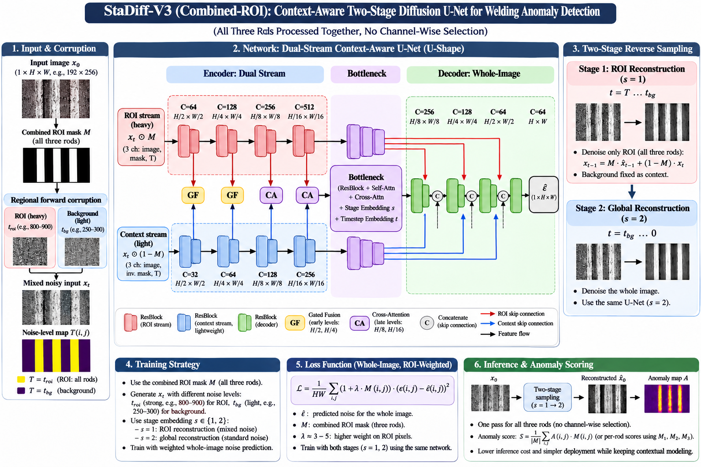

# StaDiff - Staged Diffusion, Corrupted Where It Matters
## Context-Aware Two-Stage Diffusion for Welding Anomaly Detection


<table>
  <tr>
    <td align="left" valign="top">
      <b>Khan Hamza</b><br>
      University of Milan - Bicocca<br>
      <a href="mailto:h.khan@campus.unimib.it">h.khan@campus.unimib.it</a>
    </td>
    <td width="120"></td>
    <td align="left" valign="top">
      <b>Hunor-István Lukács</b><br>
      Eötvös Loránd University<br>
      <a href="mailto:lukacs.hunor@inf.elte.hu">lukacs.hunor@inf.elte.hu</a>
    </td>
  </tr>
</table>

A diffusion model learns what **normal** weld images look like, using clean images only. At test time
the rods (the ROI) are heavily noised to erase any defect, and the background is lightly noised so the
scene stays as context. The model rebuilds the rods in two stages, and the difference between the input
and the reconstruction inside the ROI is the anomaly map.

A normal image has three evenly spaced, straight rods, each with exactly one weld in the centre.
**ROI = the rods and their welds together** (three fixed full-height columns). A bent rod, wrong spacing,
or a missing, extra or misplaced weld all change what appears inside those columns.

   

---
## 1. Folder structure

```
stadiff_v3/
├── configs/
│   ├── default.yaml          all settings (data, diffusion, model, training, evaluation)
│   └── debug_tiny.yaml       tiny model for a quick end-to-end check
├── stadiff/                  the library
│   ├── config.py             all settings and their defaults
│   ├── cli.py                named command-line flags for every setting
│   ├── data/
│   │   ├── files.py          finds Clean/Train, Clean/Test, Anomalous; validation split
│   │   ├── preprocess.py     grayscale, resize, intensity normalisation (shared by all steps)
│   │   ├── masks.py          the fixed ROI mask (rod + weld columns), per-rod masks
│   │   └── dataset.py        PyTorch Dataset / DataLoader
│   ├── diffusion/
│   │   ├── noise.py          Gaussian or Simplex noise
│   │   ├── schedule.py       regional forward process, stage sampling, losses, reverse steps
│   │   └── sampler.py        two-stage reconstruction (Stage 1 ROI only, Stage 2 whole image)
│   ├── models/
│   │   ├── blocks.py         ResBlock, attention, GatedFusion, CrossAttention2D, conditioning
│   │   └── unet.py           the dual-stream U-Net (ROI encoder + context encoder + shared decoder)
│   ├── evaluation/
│   │   ├── anomaly.py        anomaly maps (L1 / SSIM), ROI and per-rod scores
│   │   ├── metrics.py        AUROC, average precision, F1 (plain numpy)
│   │   └── runner.py         reconstruct + score a whole data loader
│   └── utils.py              seeding, device, EMA, checkpoints, visualisations
├── scripts/
│   ├── prepare_data.py       STEP 1  harmonise all images into one format
│   ├── make_mask.py          STEP 2  build the ROI mask and check it visually
│   ├── train.py              STEP 3  train on clean images
│   ├── evaluate.py           STEP 4  threshold calibration + test metrics + visualisations
│   └── infer.py              STEP 5  score new images
├── tests/                    pytest suite (run it first)
├── requirements.txt
└── pytest.ini
```

### Where StaDiff-V3 differs from a standard DDPM

Every difference is marked in the code with a comment starting with `[StaDiff-V3 ≠ DDPM]`.
To list them all:
```
grep -rn "StaDiff-V3 ≠ DDPM" stadiff/
```

| Standard DDPM | StaDiff-V3 | File |
|---|---|---|
| one timestep `t` for the whole image | per-pixel timestep map: `t_roi` inside the ROI, `t_bg` outside | `diffusion/schedule.py` |
| `t ~ U{1..T}` during training | two stages: Stage 1 = ROI at `t_roi ∈ (t_bg, t_roi_max]` with the background at `t_bg`; Stage 2 = whole image at `t ∈ [1, t_bg]` | `diffusion/schedule.py` |
| plain MSE on all pixels | Stage 1: MSE on ROI pixels only; Stage 2: ROI-weighted MSE `(1+λM)` | `diffusion/schedule.py` |
| Gaussian noise only | Gaussian **or** Simplex (one type for both regions at a time) | `diffusion/noise.py` |
| embed one `t` | embed `t_roi`, `t_bg` and the stage `s` | `models/blocks.py` (`ConditionEmbedding`) |
| one encoder | heavy ROI encoder + light context encoder | `models/unet.py` |
| — | gated fusion (H/2, H/4) and cross-attention (H/8, H/16, bottleneck): context → ROI | `models/blocks.py` |
| one set of skips | ROI skips + context skips into one shared decoder | `models/unet.py` |
| denoise everything from t to 0 | Stage 1 denoises only the ROI (background frozen), Stage 2 denoises everything | `diffusion/sampler.py` |

---

## 2. Installation

Use Python 3.10 or newer.

```bash
conda create -n stadiff python=3.11 -y
conda activate stadiff
# 1) PyTorch for your machine — see https://pytorch.org/get-started/locally/
pip install torch --index-url https://download.pytorch.org/whl/cu121   # NVIDIA GPU (CUDA 12.1)
# pip install torch                                                    # Mac (Apple silicon) or CPU
# 2) everything else
pip install -r requirements.txt
```

A CUDA GPU is strongly recommended for training. The code also runs on an Apple-silicon Mac (`mps`) and on
CPU, but full training there is very slow. If you work on a Mac, run Steps 1–2 locally and train on a GPU
machine or a cloud GPU.

## 3. Run the tests first

```bash
cd stadiff_v3
pytest -m "not slow"     # unit tests, a few seconds
pytest                   # also the end-to-end pipeline test on a synthetic dataset (about a minute)
```

All tests must pass before you use your real data. If one fails, the message shows which part is broken.

---

## 4. Step 1 — Prepare the data

Your clean images are 1600×1200 grayscale and the anomalous ones 256×256 RGB. If the two classes are processed
differently, the model can tell them apart by image quality instead of by defects. This step pushes **every**
image through the same conversion.

```bash
python scripts/prepare_data.py \
    --src /Users/macbookpro/Downloads/DATASET \
    --dst DATASET_prepared \
    --image-size 256 256 \
    --method area \
    --format png
```

| flag | meaning | values (default) |
|---|---|---|
| `--src` | your original dataset folder | required |
| `--dst` | output folder, same structure | (`DATASET_prepared`) |
| `--image-size H W` | network input size, divisible by 16 | (`256 256`) |
| `--method` | resize method | `area`, `bicubic`, `bilinear_noaa` (`area`) |
| `--format` | output file type | `png`, `jpg` (`png`) |
| `--jpeg-quality` | quality when `--format jpg` | (`95`) |

It writes `manifest.csv` and prints a sharpness table per subset and camera setup. **Within the same setup,
clean and anomalous sharpness should be close.** They won't match exactly, because a missing weld also changes
how much detail an image has. If the gap is large, try another `--method` (and `--format jpg`) into a new
`--dst` and keep the closest one. Whatever method you keep, pass it to training as `--prepare-method`, so new
images in Step 5 are processed the same way.

## 5. Step 2 — Build and check the ROI mask

```bash
python scripts/make_mask.py --data DATASET_prepared --mask-source rods --out runs/mask
# your own mask instead:
python scripts/make_mask.py --data DATASET_prepared --mask-source file --mask-path my_mask.png --out runs/mask
```

Open `runs/mask/mask_check.png`. In every **clean** image, each red column must contain one straight rod with its
weld. To change the columns, edit `ROD_BOXES` in `stadiff/data/masks.py` (fractions `x0, y0, x1, y1`), or draw a
mask PNG (white = ROI). Narrower columns detect smaller bends but give more false alarms.

## 6. Step 3 — Train

Quick check that everything runs (tiny model, a few minutes):
```bash
python scripts/train.py --config configs/debug_tiny.yaml --data DATASET_prepared
```

A full training run, with the most important settings written out:
```bash
python scripts/train.py \
    --data DATASET_prepared \
    --out runs/gauss_800_400 \
    --noise gaussian \
    --t-roi 800 \
    --t-bg 400 \
    --mask-source rods \
    --image-size 256 256 \
    --prepare-method area \
    --batch-size 8 \
    --lr 1e-4 \
    --iters 100000 \
    --lam 4.0 \
    --p-stage1 0.5 \
    --device cuda
```

More examples:
```bash
# Simplex noise (a separate model: a model only denoises the noise type it was trained with)
python scripts/train.py --data DATASET_prepared --out runs/simplex_800_400 --noise simplex --simplex-scale 32 --t-roi 800 --t-bg 400

# t_bg selectable at test time: train over a range of background levels
python scripts/train.py --data DATASET_prepared --out runs/gauss_randbg --noise gaussian --t-roi 900 \
    --t-bg 400 --random-bg true --t-bg-min 200 --t-bg-max 500

# ablations
python scripts/train.py --data DATASET_prepared --out runs/abl_single_stream --use-context-stream false
python scripts/train.py --data DATASET_prepared --out runs/abl_no_fusion --fusion none none none none --bottleneck-cross-attn false
python scripts/train.py --data DATASET_prepared --out runs/abl_weld_roi --mask-source welds

# continue an interrupted run (give the same flags as before + --resume)
python scripts/train.py --data DATASET_prepared --out runs/gauss_800_400 --noise gaussian --t-roi 800 --t-bg 400 \
    --resume runs/gauss_800_400/ckpt_last.pt
```

All training flags (`python scripts/train.py --help` prints them with their defaults):

| group | flags |
|---|---|
| data | `--data` `--image-size H W` `--prepare-method` `--norm percentile\|none` `--mask-source rods\|welds\|file` `--mask-path` `--val-fraction` `--split-seed` `--augment true\|false` |
| diffusion | `--noise gaussian\|simplex` `--t-roi` `--t-bg` `--random-bg true\|false` `--t-bg-min` `--t-bg-max` `--t-total` `--beta-schedule linear\|cosine` `--beta-start` `--beta-end` `--p-stage1` `--lam` `--simplex-scale` `--simplex-octaves` `--simplex-persistence` |
| model | `--roi-channels …` `--ctx-channels …` `--dec-channels …` `--roi-blocks` `--ctx-blocks` `--dec-blocks` `--emb-dim` `--attn-heads` `--dropout` `--fusion gated\|cross\|none ×4` `--use-context-stream true\|false` `--bottleneck-cross-attn true\|false` |
| training | `--out` `--batch-size` `--lr` `--weight-decay` `--iters` `--warmup-iters` `--ema-decay` `--grad-clip` `--amp true\|false` `--num-workers` `--log-every` `--val-every` `--ckpt-every` `--preview-every` `--seed` `--resume` |
| other | `--device auto\|cuda\|cuda:1\|mps\|cpu` `--config file.yaml` `--set key=value …` |

Rules (checked automatically): `1 ≤ t_bg < t_roi ≤ t_total`. With `--random-bg true`:
`t_bg_min ≤ t_bg ≤ t_bg_max < t_roi`.

What to watch in the `--out` folder:
* console / `log.csv`: `loss`, `loss_stage1`, `loss_stage2` fall and then flatten. `val_loss` is the same
  loss on held-out clean images.
* `previews/preview_*.png`: rows of **input | reconstruction | anomaly map** for clean validation images.
  Reconstructions should show three straight rods with one weld each, and the maps should turn dark.
* `ckpt_best.pt` (lowest validation loss, use it for evaluation), `ckpt_last.pt` (for `--resume`).

If you run out of GPU memory, lower `--batch-size`. If the loss jumps around, lower `--lr`.

## 7. Step 4 — Evaluate

The training settings (noise type, t values, mask, image size) are stored in the checkpoint and reused
automatically. You only choose **evaluation** settings:

```bash
python scripts/evaluate.py \
    --checkpoint runs/gauss_800_400/ckpt_best.pt \
    --t-roi 800 \
    --t-bg 400 \
    --sampler ddim \
    --steps-stage1 50 \
    --steps-stage2 50 \
    --n-samples 1 \
    --map l1 \
    --smooth-sigma 2.0 \
    --reduce topk \
    --topk-frac 0.02 \
    --image-score max_rod \
    --threshold-percentile 99 \
    --save-vis 40 \
    --device cuda
```

| flag | meaning | values (default) |
|---|---|---|
| `--checkpoint` | trained model | required |
| `--t-roi` | ROI noise level at test time, ≤ trained value | (trained value) |
| `--t-bg` | background level; can differ only for a `--random-bg true` model | (trained value) |
| `--sampler` | `ddim` fast and deterministic, `ddpm` every step (slow) | (`ddim`) |
| `--steps-stage1`, `--steps-stage2` | DDIM network calls per stage | (`50`, `50`) |
| `--n-samples` | reconstructions averaged per image | (`1`) |
| `--map` | anomaly map | `l1`, `ssim`, `l1+ssim` (`l1`) |
| `--smooth-sigma` | blur of the map in pixels | (`2.0`) |
| `--reduce`, `--topk-frac` | pixels → region score | `mean`, `max`, `topk` (`topk`, `0.02`) |
| `--image-score` | `max_rod` = worst rod decides, `roi` = whole ROI | (`max_rod`) |
| `--threshold-percentile` | threshold = this percentile of clean validation scores | (`99`) |
| `--save-vis` | images in the visualisation sheets | (`40`) |
| `--data` | evaluate on another prepared folder | (training folder) |
| `--out` | results folder | (next to the checkpoint) |
| `--batch-size`, `--seed`, `--device` | | (`8`, `0`, `auto`) |

What it does and writes:
1. **Threshold, without looking at anomalies:** clean validation images are reconstructed and scored, and the
   threshold is the chosen percentile of their scores.
2. **Test:** every image in `Clean/Test` and `Anomalous` is reconstructed and scored.
3. `metrics.json`
   * `auroc`, `average_precision`: threshold-free quality
   * `at_calibrated_threshold`: precision, recall, F1, confusion matrix. This is the honest operating point.
   * `best_f1_oracle`: best F1 over all thresholds. It uses test labels, so it is an upper bound only.
   * `per_group`: everything per camera setup (bright / dark)
4. `scores.csv` (score and decision per image, score per rod), plus `vis_clean.png` and `vis_anomalous.png`
   (rows of input | reconstruction | anomaly map).

Sweep the ROI noise level without retraining:
```bash
for t in 500 600 700 800; do
  python scripts/evaluate.py --checkpoint runs/gauss_800_400/ckpt_best.pt --t-roi $t
done
```

## 8. Step 5 — Score new images

```bash
python scripts/infer.py \
    --checkpoint runs/gauss_800_400/ckpt_best.pt \
    --images path/to/new_images \
    --metrics runs/gauss_800_400/eval_ckpt_best_troi800_tbg400/metrics.json \
    --out runs/infer \
    --device cuda
```

* `--images`: one image file or a folder. Raw camera images are fine; they are prepared like the training data.
* `--metrics`: the `metrics.json` from Step 4. Its threshold **and** its evaluation settings (t_roi, map,
  sampler, …) are reused automatically, so scores and threshold match.
* `--threshold 0.123`: set the threshold yourself instead.
* Every evaluation flag (`--t-roi`, `--n-samples`, `--map`, …) is available here too and overrides the stored one.

It prints each image's score, the verdict (normal / ANOMALOUS) and the rod with the highest score. It writes
`results.csv` and one visualisation per image to `runs/infer/maps/`.

## Configuration files (optional)

Every flag also exists as a key in `configs/default.yaml`. You can keep a set of settings in your own YAML
and add flags on top of it: `python scripts/train.py --config my_settings.yaml --t-roi 700`.
Priority: built-in defaults < `--config` file < named flags < `--set key=value`.

---

## 9. Experiments worth reporting

| Question | How |
|---|---|
| Gaussian vs Simplex noise | train two models (`--noise gaussian`, `--noise simplex`) |
| effect of the ROI noise level | one model, evaluate with several `--t-roi` |
| effect of the background level | train with `--random-bg true`, evaluate with several `--t-bg` |
| is the context stream useful? | `--use-context-stream false` |
| are fusion / cross-attention useful? | `--fusion none none none none --bottleneck-cross-attn false` |
| rod+weld ROI vs weld-only ROI | `--mask-source welds` |
| robustness across camera setups | `per_group` in `metrics.json` |

Also report results separately for each anomaly type (missing weld vs. bent/misaligned rod). Missing welds
are much easier to detect, so an average over both hides how well the model handles bends.

## 10. Things to keep in mind

* **The model only knows normal images.** Do not put any anomalous image into `Clean/Train`.
* **Setup bias.** If most anomalous images come from one camera setup, a model can score well by recognising
  the setup. Check `per_group` and make sure both setups appear among clean and anomalous test images.
* **Framing.** A few anomalous samples show a different camera position (the top of the fixture is visible).
  If that framing never occurs in the clean data, those images will be flagged for the framing, not the defect.
* **Threshold quality** depends on the number of clean validation images. With very few, the 99th percentile
  is unreliable; raise `--val-fraction` when training or use a lower `--threshold-percentile`.
